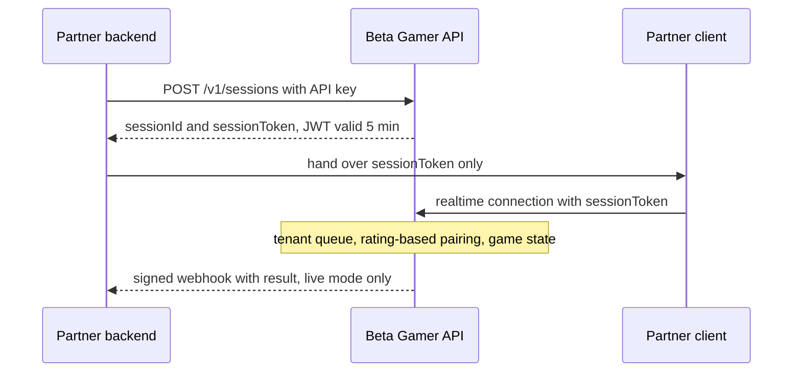

<h1>Ado Daniel NJI</h1>

> **Engineering Secure, Automated & Adaptable Systems**

<p>
  <a href="https://adodanielnj.vercel.app">Portfolio</a> ·
  <a href="https://www.linkedin.com/in/iamsupreme/">LinkedIn</a> ·
  <a href="https://dev.to/adodanieln">DEV</a> ·
  <a href="mailto:adodanieln@gmail.com">Email</a>
</p>

I build the systems underneath a product: APIs, stateful services, integrations, and automation and AI workflows. I try to start from the product problem: what the thing has to do, who or what will call it, and what has to stay true when requests are retried, state is shared, or another team builds on top of it. The stack comes after that.

<sub>Software developer · Cameroon</sub>

---

## Selected work

<sub>Several of these are private codebases, so each entry says what the project does and links code only where it's public.</sub>

### Beta Gamer
<sub>Live · built solo</sub>

[Site](https://bhetagamer.com) · [Docs](https://docs.bhetagamer.com) · [React SDK](https://www.npmjs.com/package/@beta-gamer/react) · [React Native SDK](https://www.npmjs.com/package/@beta-gamer/react-native) · [How the matchmaker works](https://dev.to/adodanieln/how-i-built-the-matchmaking-engine-behind-beta-gamer-3jk6)

A games-as-a-service platform: an app that wants multiplayer games calls an API instead of building game servers and matchmaking of its own.



- **Keys stay on the server.** The client only ever holds a session token, a JWT that expires after five minutes. Test and training modes sit alongside live, and webhooks fire in live mode only.
- **Tenant-isolated matchmaking.** Queues belong to the partner and pairing is rating-based, so players only meet others from the same app.
- **Group-first.** A match is a list of groups, and a group can be one player. A 1v1, four-player Ludo and a 2v2 are the same structure with different configuration. The matchmaker decides who plays whom; the game engine owns turns and rules.
- **Session types.** Queue-matched, private room (joined by room code), or a bot match. Hosted matchmaking is the explicit route: the partner's backend submits pre-formed groups or starts a match directly instead of using the auto-queue.
- **Bots.** Partners can inject bots into pending or live sessions with an API call, either a specific bot of their own or one from their configured pool. An internal event bus carries the request from the REST layer into the live WebSocket room.

Ten games are playable, and the React and React Native SDKs are on npm.

### Task Manager API
<sub>Public code · built for a skill assessment</sub>

[Code](https://github.com/acetennyson/global-tech-trial) · [Playground](https://global-tech-trial.vercel.app)

A REST API on Next.js route handlers and Supabase Postgres, with JWT auth, built to work through failure cases rather than to pile up features. When two people edit the same task, the second save carries a stale version and gets the current task back instead of overwriting the first:

```text
PATCH /api/tasks/:id   { "status": "done", "version": 3 }

409 Conflict           { "error": { "details": { "current": { … } } } }
```

<details>
<summary>Other cases it's written to handle</summary>

```text
retried create           → original task (200)
same key, other body     → 422
bulk, one bad id         → 404/403, nothing written
reset link used twice    → rejected (single-use)
forgot-password          → 200 for any email
wrong pw / unknown user  → same 401, dummy hash compared
repeated failed logins   → 429 + Retry-After
```

Rate-limit counters live in Postgres, so serverless instances share them. Deletes are soft: the row stays as a tombstone with a `task.deleted` event, and `GET /api/sync` replays events from a cursor so an offline device learns what was removed. Tombstones are purged after a retention window (30 days by default). `POST /api/sync` applies a batch of operations in order, each with its own idempotency key, and returns what was accepted, conflicted or rejected.

</details>

> [!NOTE]
> Server side only: there is no offline client and no reset-password page yet. The README lists these, along with known limitations and a prioritised scaling plan.

### JobHub
<sub>Live</sub>

[Live](https://jobhub-psi.vercel.app)

Ranks job listings against a candidate's skills, seniority and location, and shows why each one matched. The score combines TF-IDF with cosine similarity and Jaro-Winkler string similarity, so it goes beyond keyword overlap. Employers are verified before they can post, candidates get alerts when a strong new match appears, and API keys and webhooks let other platforms push listings in or pull them out.

### NightShift
<sub>Public code · built for the Notion MCP Challenge</sub>

[Code](https://github.com/acetennyson/global-freelancer-assistant) · [Demo](https://global-freelancer-assistant.vercel.app)

**Notion client record → AI draft → your approval → sent when the client's window opens**

Each client's time zone and availability window live in a Notion database. Drafts use previously sent messages as context, and nothing is sent without approval. A scheduled job runs every 15 minutes and sends approved drafts whose window has opened. Several AI providers are wired in with key rotation, and an MCP server exposes three tools to Claude Desktop.

### Also

- **Mbende Stay** · *live, contributor.* A property listing and rental platform for Cameroon ([mbendestay.com](https://mbendestay.com)). I work on backend and product features.
- **SafeCircle** · *hackathon build.* Guardian mobile apps (Capacitor) and GPS trackers connected over persistent Socket.IO connections, with real-time alerts, a community safe-zone feed and AI-assisted post classification.
- **Axir** · *in development.* An AI assistant being built toward a workspace where organizations configure their own agents. So far: tool execution and orchestration, model-provider abstraction, task persistence and multi-tenancy.

---

## Range

**Boundaries and access** · <sub>Beta Gamer, Task Manager API</sub><br>
Tenant isolation, API keys, short-lived session tokens, signed webhooks, hashed single-use reset tokens, parameterized SQL with allow-listed identifiers.<br>
`JWT` `bcrypt` `HMAC` `Zod`

**Consistency under failure** · <sub>Task Manager API, Beta Gamer</sub><br>
Idempotent writes, optimistic versioning, transactional bulk operations, tombstones and change events for sync, shared rate limits, reconnection windows for dropped players.<br>
`PostgreSQL` `Supabase`

**Real-time and connected devices** · <sub>Beta Gamer, SafeCircle</sub><br>
Room state, nested-group matchmaking, bot injection into live sessions, GPS trackers on persistent connections.<br>
`Socket.IO` `WebSockets` `Redis`

**Matching and AI** · <sub>JobHub, NightShift, Axir</sub><br>
Explainable ranking, multi-provider model integration with key rotation, MCP servers, scheduled workflows, agent tool execution.<br>
`MCP` `Gemini` `Claude` `Groq` `Notion API`

**Clients, SDKs and delivery**<br>
React and React Native SDKs, Capacitor mobile apps, web front ends, payment integrations, deployment and CI.<br>
`React` `React Native` `Capacitor` `Next.js` `MTN MoMo` `Orange Money` `Tranzak` `Stripe` `PayPal` `Vercel` `Docker` `GitHub Actions`

<sub>Languages: TypeScript, JavaScript, PHP.</sub>

---

## On GitHub
<p align="center">
  <a href="https://gitscore.live/acetennyson">
    <picture>
      <source media="(prefers-color-scheme: dark)" srcset="https://gitscore.live/api/badge/acetennyson?style=card&theme=dark" />
      
    </picture>
  </a>
</p>

<p align="center">
  <picture>
    <source media="(prefers-color-scheme: dark)" srcset="https://github-readme-stats.vercel.app/api?username=acetennyson&amp;show_icons=true&amp;theme=tokyonight&amp;include_all_commits=true&amp;count_private=true&amp;hide_border=true&amp;bg_color=0D1117">
    
  </picture>
  <picture>
    <source media="(prefers-color-scheme: dark)" srcset="https://github-readme-stats.vercel.app/api/top-langs/?username=acetennyson&amp;layout=compact&amp;langs_count=7&amp;theme=tokyonight&amp;hide_border=true&amp;bg_color=0D1117">
    
  </picture>
</p>

<p align="center">
  <picture>
    <source media="(prefers-color-scheme: dark)" srcset="https://streak-stats.demolab.com?user=acetennyson&amp;theme=tokyonight&amp;hide_border=true&amp;background=0D1117">
    
  </picture>
</p>

<p align="center"><sub>Much of the work above is in private repositories, so public activity understates it.</sub></p>

---

## Contact

If you'd have made a different call on something here, I'd like to hear it. Issues are open on [Task Manager API](https://github.com/acetennyson/global-tech-trial) and [NightShift](https://github.com/acetennyson/global-freelancer-assistant), and [email](mailto:adodanieln@gmail.com) works too. I write about what I'm learning on my [site](https://adodanielnj.vercel.app/blog) and on [DEV](https://dev.to/adodanieln).
